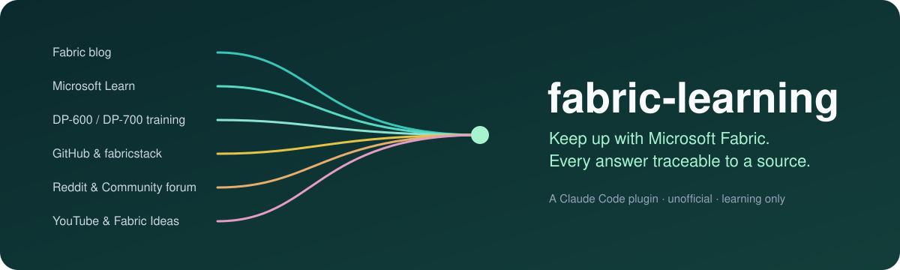
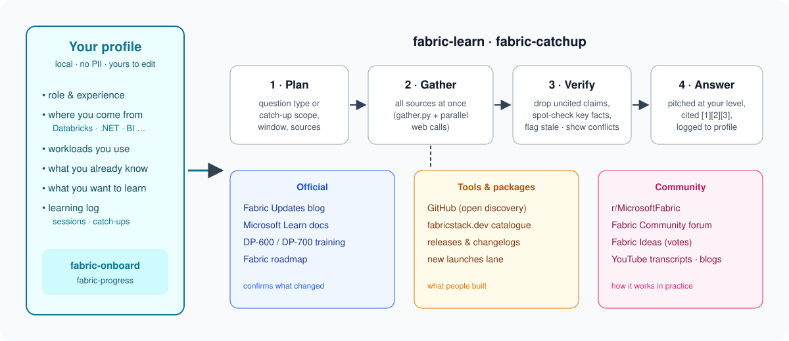

<p align="center">
  
</p>

<p align="center">
  <a href="#install"></a>
  
  
  <a href="LICENSE"></a>
</p>

# fabric-learning

**A study buddy for Microsoft Fabric that reads everything, cites everything, and remembers what you already know.**

Microsoft Fabric ships faster than anyone can read. A single FabCon produces dozens of blog posts, hours of sessions, hundreds of Reddit comments and a wave of new community tools on GitHub. Answers that were right six months ago are quietly wrong today. `fabric-learning` is a Claude Code plugin that does the reading for you: it goes to the official blog, Microsoft Learn, certification training, Reddit, the Fabric Community forum, Fabric Ideas, YouTube transcripts and GitHub, and turns all of it into an answer pitched at *your* level, with a link behind every claim.

> [!IMPORTANT]
> **This is not a Microsoft product**, and it isn't affiliated with or endorsed by Microsoft. It's an independent, community-built learning tool that **collects and collates publicly available information** so you can keep up with Microsoft Fabric. It never connects to your Fabric tenant, and it can't change anything in it. Always check the linked sources before acting on anything, especially features in preview.

---

## Why this exists

| The problem | What the plugin does about it |
|---|---|
| News is scattered across a blog, docs, forums, Reddit, YouTube and GitHub | Searches all of them **in parallel** and merges duplicates into single items |
| LLMs answer Fabric questions confidently, from training data that's months out of date | **No source, no statement.** Every factual sentence carries a `[n]` citation, and anything unverifiable is dropped or labelled |
| Community tools (like FUAM) never show up in official channels | Open GitHub discovery, plus the [fabricstack.dev](https://fabricstack.dev) catalogue, with **a reserved lane for brand-new tools** so stars don't bury them |
| Generic answers ignore where you're coming from | A short onboarding builds a local profile. Explanations map Fabric onto what you already know (Databricks, .NET, Power BI…) and skip what you've told it you know |
| Preview features change under your feet | Every feature gets a status label (Preview / GA / Planned / Deprecated), and stale sources are flagged by age: 6 months for preview, 12 for GA |

---

## The four skills

Claude picks the right skill from what you type. You don't need to remember commands, but each one also has a slash command.

| Skill | Ask it things like… | What you get | Slash command |
|---|---|---|---|
| 🧭 **fabric-onboard** | *"Set me up, I'm coming from Databricks"* | A 2-minute questionnaire with branching questions (role, experience, background, workloads, depth). It builds your profile, and you can re-run it as you grow | `/fabric-learning:fabric-onboard` |
| 📚 **fabric-learn** | *"What are Ontologies in Fabric?"* · *"Why does my Spark notebook time out on a left join?"* · *"Is there a tool to copy data across capacities?"* | A researched, cited explanation, shaped by question type: concept, how-to, scenario design, admin setting, comparison, problem solving or tool discovery | `/fabric-learning:fabric-learn` |
| 📰 **fabric-catchup** | *"What was announced at FabCon Barcelona?"* · *"Catch me up"* · *"Anything new for Power BI lately?"* | A personalised digest: **For you**, changes to things you know, tools & packages (new launches + updates), community picks, videos worth watching, each with a status, date and link | `/fabric-learning:fabric-catchup` |
| 📈 **fabric-progress** | *"What have I learned?"* · *"What should I learn next?"* · *"Mark Eventstreams as learned"* | Your learning dashboard: known topics, covered-but-not-claimed topics, skipped catch-up periods, refresh reminders, recommendations, plus export and delete | `/fabric-learning:fabric-progress` |

<p align="center">
  
</p>

---

## Install

**Requirements**
- [Claude Code](https://claude.com/claude-code): CLI, desktop app or IDE extension.
- Python 3.9+. The scripts use only the standard library. On Windows, Claude uses `python` or `py` if `python3` isn't on your PATH.
- [GitHub CLI](https://cli.github.com) (`gh`), logged in, for the GitHub source. Recommended; without it, GitHub falls back to web search.
- Internet access. `yt-dlp` (for YouTube transcripts) installs itself on first use into a private virtual environment, so nothing system-wide.

**In Claude Code:**

```text
/plugin marketplace add blaine12100/fabric-learning
/plugin install fabric-learning@fabric-learning
```

Restart Claude Code if it asks you to. That's it.

<details>
<summary>Installing from a local clone instead</summary>

```bash
git clone https://github.com/blaine12100/fabric-learning.git
```
```text
/plugin marketplace add ./fabric-learning
/plugin install fabric-learning@fabric-learning
```
</details>

---

## Your first five minutes

1. **Start with onboarding.** Type:
   > Set up my Microsoft Fabric learning profile

   Answer a handful of multiple-choice questions. They adapt to you: a .NET developer who has never used Fabric gets asked about their stack, not about Eventhouses. The free-text question at the end ("anything you already know well or want to learn next?") is optional, but it makes everything after it sharper.

2. **Ask something you actually need.**
   > How does Direct Lake fall back to DirectQuery, and how can I tell when it's happening?

3. **Catch up.**
   > Catch me up on Fabric

   The first catch-up covers the last 14 days. After that, "catch me up" always starts exactly where you left off, even months later. For a long gap, it asks whether you want highlights, month by month, or just the last N days.

4. **Check your progress.**
   > What should I learn next?

Skipped onboarding? No problem: the other skills offer it once and still answer you.

---

## Things to ask, by persona

<details open>
<summary><b>🔁 Migrating from Databricks</b></summary>

- *How does a Fabric Lakehouse compare to a Databricks lakehouse with Unity Catalog?*
- *What's the Fabric equivalent of Databricks Jobs and clusters, and how is compute billed?*
- *Is there a tool to migrate notebooks from Databricks to Fabric?*
</details>

<details>
<summary><b>💻 Software engineer moving into data</b></summary>

- *How do I set up CI/CD for Fabric with Git and deployment pipelines?*
- *Which Fabric tasks can I automate from C#, and which are Python- or SQL-first?*
- *Explain Spark DataFrames to me like I know LINQ*
</details>

<details>
<summary><b>📊 Power BI / data analyst</b></summary>

- *How do calculation groups work in Power BI semantic models in Fabric?*
- *Direct Lake vs Import: when should I switch?*
- *Anything new for Power BI and semantic models lately?*
</details>

<details>
<summary><b>🏗️ Pre-sales / architect</b></summary>

- *A customer asked about the new Planning feature. How does it work, and is it GA?*
- *Design a near-real-time IoT pipeline on Fabric for a mid-size manufacturer*
- *What was announced at FabCon Barcelona?*
</details>

<details>
<summary><b>🛡️ Admin / platform owner</b></summary>

- *Our F64 keeps throttling every morning. What can we do?*
- *What does the "Users can create Fabric items" tenant setting actually control?*
- *Is there a community tool for monitoring capacity usage across workspaces?*
</details>

---

## Where the answers come from

| Group | Sources | Used for |
|---|---|---|
| **Official** | Fabric Updates blog · Power BI Updates blog · Microsoft Learn docs · DP-600 / DP-700 training · Fabric roadmap | What Fabric does, what changed, release status |
| **Tools & packages** | GitHub (open discovery, releases, issues) · [fabricstack.dev](https://fabricstack.dev) | Community and Microsoft tools, new launches, package updates |
| **Community** | r/MicrosoftFabric · Fabric Community forum · Fabric Ideas · YouTube transcripts · community blogs | Real-world experience, fixes, gotchas, what people are asking for |

### The trust model

- **Every claim has a link.** Sources are listed with their authority and engagement, e.g. `r/MicrosoftFabric · community · 23 comments · Mar 2026`, or `Microsoft Learn · official · updated Jun 2026`.
- **Authority needs evidence.** "Expert" means a visible badge or role, such as Microsoft Employee flair or Super User. A famous-sounding name isn't enough.
- **Official confirms; community reacts.** A feature only counts as *released* if Microsoft says so. Rumours are labelled `unconfirmed — community report`.
- **Conflicts are shown, not hidden.** When Reddit and the docs disagree, you see both, with dates.
- **Popularity ≠ correctness.** Upvotes and stars rank community items, but never outrank authority, and new tools get a protected place.

### How research runs, and why sub-agents are capped at two

Most questions are answered by **one Claude, with no sub-agents**. It runs every source script at once in one call, and all its web look-ups at once in another.

Sub-agents (helper Claudes that read in parallel) are used only when the work genuinely splits into independent pieces: a catch-up spanning several months, a comparison with separate parts, or several long videos or threads to read. Even then:

| Rule | Why |
|---|---|
| **0 by default, 2 at most at any moment** | Sub-agents are expensive. Anthropic measured that multi-agent systems use **about 15× more tokens than a chat** ([How we built our multi-agent research system](https://www.anthropic.com/engineering/multi-agent-research-system)). Every one also counts against your Claude usage limits. While testing this plugin, running many in parallel hit the session limit and runs failed. Two at a time keeps the speed-up and keeps your session alive. |
| **Only for independent work** | The same article notes that work where every agent needs the same context, or which has many dependencies, isn't a good fit. A single question about one feature is faster and cheaper answered inline. |
| **They run on a cheaper model (Sonnet)** | They only gather and summarise sources, with restricted tools. The main conversation keeps your model for judging, verifying and writing. Anthropic found that a stronger lead model with Sonnet sub-agents beat a single top model by 90% on its research evaluation ([same article](https://www.anthropic.com/engineering/multi-agent-research-system)). Claude Code recommends routing tasks to lower-cost models to [control costs](https://code.claude.com/docs/en/sub-agents). |
| **They never talk to you, write your profile or check citations** | The main conversation merges their findings, spot-checks them, runs the citation check and writes the log. A failed sub-agent's share is finished inline, or reported as a gap. |

You never need to ask for sub-agents or turn them off: the plugin decides.

---

## Your data stays yours

Everything lives in plain files on your machine:

```text
~/.claude/fabric-learning/
├── profile.json         # what you told onboarding + topics you've marked as known / want to learn
├── learning-log.jsonl   # what each session and catch-up covered (with source links)
└── cache/               # temporary
```

- **No personal data.** The helper rejects email addresses and tenant or workspace IDs outright.
- **Read it, edit it, export it, delete it.** Ask *"export my learning history"* or *"delete all my fabric learning data"*. Every deletion shows you exactly what will go first.
- Set `FABRIC_LEARNING_HOME` to keep the data somewhere else.

---

## Honest limitations

- **It researches live, so it isn't instant.** A deep question or a big catch-up can take a few minutes and a fair number of tokens. Simple questions stay light; heavy reading is handed to at most two sub-agents at a time, and only when it's worth it (see [How research runs](#how-research-runs-and-why-sub-agents-are-capped-at-two)).
- **Some sites resist automation.** The Fabric Community site blocks page fetches, so the plugin uses its public RSS feeds instead. Those carry full post text, but no kudos or vote counts. Reddit's RSS is rate-limited, so community reaction is sometimes thin, and the digest says so when it is.
- **LinkedIn isn't used.** There's no public API, and scraping it breaks LinkedIn's terms.
- **It can still be wrong.** Citations make mistakes *checkable*, not impossible. Click through before you act, especially on preview features.

---

## Repository layout

```text
.claude-plugin/        plugin.json + marketplace.json
agents/
  fabric-researcher.md internal research worker (used only by learn/catchup, Sonnet, restricted tools)
skills/
  fabric-onboard/      SKILL.md
  fabric-learn/        SKILL.md
  fabric-catchup/      SKILL.md
  fabric-progress/     SKILL.md
references/
  sourcing-rules.md    shared: sources, citation rules, findings contract, authority, verification
  data-model.md        shared: profile, learning log, helper commands
scripts/
  profile.py           local state (validated, PII-checked)
  gather.py            runs several source scripts concurrently in one call
  check_citations.py   flags uncited sentences before an answer is shown
  community.py         Fabric blog, Power BI blog, Community forum, Fabric Ideas (RSS)
  learn.py             Microsoft Learn docs, training, exam study guides (public search + catalog APIs)
  reddit.py            r/MicrosoftFabric (RSS, paced)
  youtube.py           search + timestamped transcripts (yt-dlp)
  github.py            open discovery: new launches, releases, tool search, issues
  fabricstack.py       fabricstack.dev catalogue
  lib/                 shared library: cache, HTTP, feeds (RSS/Atom), dates, text, CLI runner, tool installs
tests/                 offline unit tests (python3 -m unittest discover tests)
assets/                README images
```

## Contributing

Issues and pull requests are welcome, especially:
- New high-signal sources, which must be public and allowed to be accessed automatically.
- Better question-type layouts.
- Reports of an answer that cited a source which didn't support it. Include the prompt and the citation.

When you change a skill, keep the shared rules in `references/` as the single source of truth.

### Adding a source

Source scripts are thin adapters over `scripts/lib/`, so a new source is usually 50–100 lines:

1. Create `scripts/<source>.py`. Build URLs or commands, and fetch with `lib.fetch.get_json`, `lib.feeds.fetch_feed` (RSS or Atom) or `lib.commands.run_cached` (a CLI). Map the responses onto result dicts with `title`, `url` and `published` (ISO, via `lib.dates.iso_date`), plus whatever engagement fields the source has.
2. Wire the commands with `lib.cli`: `parser`, `add_window` / `add_text` / `add_limit`, and `run(commands, args, fallback)`. Raise `SourceUnavailable` for anything that goes wrong; `run` turns it into exit 3 with your fallback. Print with `emit_results`.
3. Register the script in `lib.SOURCES` so `gather.py` can run it.
4. Add a row to the source table in `references/sourcing-rules.md` (what it's for, how it's accessed, its authority).
5. Add tests for any parsing in `tests/`, and run `python3 -m unittest discover tests`.

Scripts use only the Python standard library (3.7+), so nothing needs installing.

## Acknowledgements

- [fabricstack.dev](https://fabricstack.dev) for its community tool catalogue (CC BY 4.0).
- [last30days-skill](https://github.com/mvanhorn/last30days-skill) (MIT) for showing that keyless Reddit access and `yt-dlp` transcripts make a great research backbone.
- The r/MicrosoftFabric and Fabric Community regulars whose answers make this plugin useful.

## Licence

[MIT](LICENSE). Microsoft, Microsoft Fabric, Power BI and related marks are trademarks of the Microsoft group of companies. They're used here only to describe what this independent project is about.
